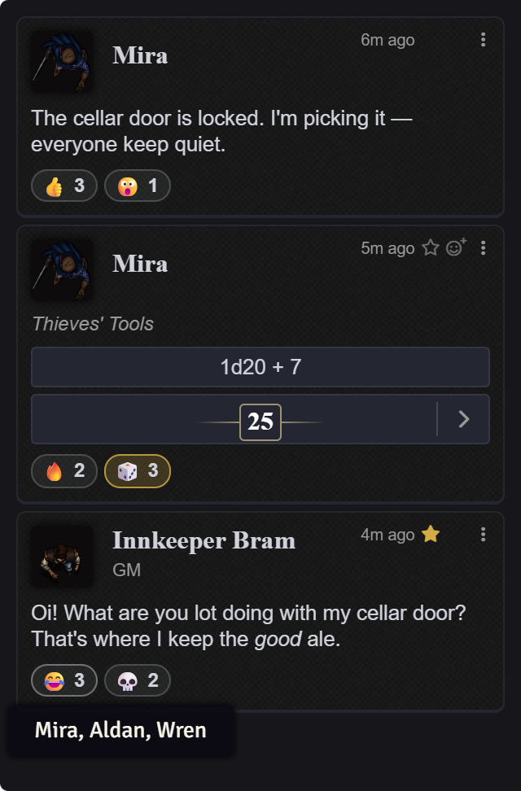
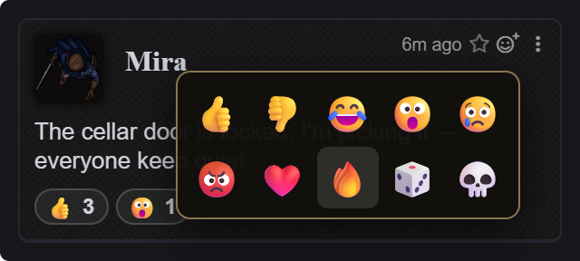
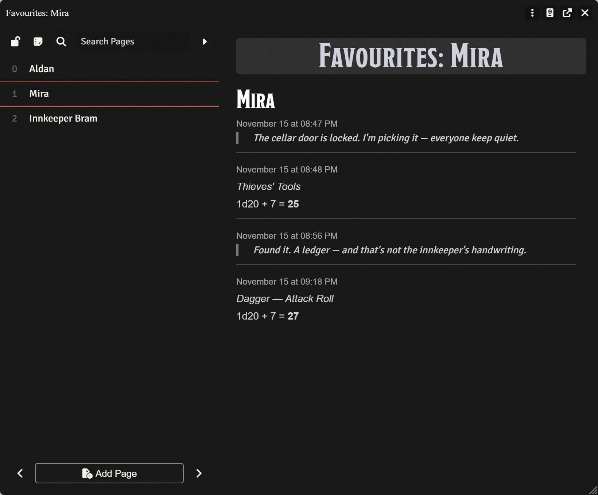

# UO · Chat Reactions

**English** · [Русский](README.ru.md)

Emoji reactions under any chat message in Foundry VTT: a line, a roll, an item
or spell card. The number next to an emoji is how many people gave it; hover
to see who. Reply to a message with a quote, and a star saves it to your own
favourites journal.



## Installation

In Foundry's **Install Module** dialog, paste the manifest URL:

```
https://github.com/Nikifour/uo-chat-reactions/releases/latest/download/module.json
```

- Foundry VTT **v13–v14**, **any game system**, no other modules required.
- The interface is in **English and Russian**: it follows Foundry's language,
  or pick one in the module settings.
- A guide ships with the module as a compendium: *Chat Reactions · How to use*.

## How to react

- Hover over a message: a smiley appears in its header, next to the time.
  Click it and choose an emoji.
- Click an emoji under a message to add the same one or take yours back.
  Your own reactions are highlighted in gold.
- One message can have several emoji.
- Besides emoji, the GM can add custom image icons to the set.



## Replies

The arrow next to the smiley lets you reply to a message, the way social
networks do. A bar appears above the chat input; send your message as usual
and a quote of the original appears above it. Click the quote to jump to the
original, even one far up the chat. Under the original a counter shows how
many replies it has; click it to go through them one by one.

A reply to a whisper goes as a whisper to the same people, and the quote of a
whisper is visible only to those who saw the whisper itself. If you pick the
recipients yourself with `/w`, the module leaves your choice alone.

## Favourites

The star next to the smiley saves the message to your journal
**"Favourites: your name"** in the "Favourites" folder: when it was said and
what; for a roll, the formula and the total. The journal is yours — you and
the GM can see it, everyone else cannot.

How entries are arranged into pages is everyone's own choice:

- **a page for each speaker** (the default) — everything one character said
  on one page. A hero is recognised by their sheet, so a renamed token does
  not split the page in two;
- **a page for each participant** — everything from one player or GM, with
  all of their characters, on one page; every entry says who was speaking;
- **a page for each message**.



On a shared page entries run in the order the messages were sent. An entry
is a copy, not a link: if the message is deleted or the chat is cleared, it
stays. Click the star again to remove the message — only its entry leaves
the page. The same is in the message's right-click menu.

A whisper can be saved only by those it was addressed to, a blind roll only
by the GM.

## How it works

Reactions are stored as a flag on the message itself, one entry per
participant, so two reactions at the same moment never overwrite each other,
and everything is still there after a reload.

Foundry does not let players change other people's messages, so such a
reaction is recorded by the active GM: the request goes to the GM's client
over the module's socket. The sender is identified by the Foundry server,
so nobody can react in someone else's name. With no GM in the game you can
react only to your own messages.

Players cannot create journals either, so the first favourite is written by
the GM's client, which creates the journal and gives it to the player. After
that the player writes to their journal directly.

## Settings

*Game Settings → Configure Settings → UO · Chat Reactions*:

| Setting | Default | What it does |
|---|---|---|
| Reaction set | 👍 👎 😂 😮 😢 😡 ❤️ 🔥 🎲 💀 | the emoji in the picker, separated by spaces |
| Favourites: pages (per user) | a page for each speaker | how favourites are arranged in your journal |
| Custom icons | — | your own images in the reaction set |
| Replies to messages | on | the reply arrow and the reply counter |
| Module language (per user) | Same as Foundry | Russian if Foundry is in Russian, English otherwise; or pick one |

Emoji removed from the set stay under the messages where they were already
given, and you can always take yours back.

**Custom icons** (*Custom icons → Edit icons*, GM only): your own images in the
reaction set, next to the emoji — a party crest, the innkeeper's face, a mug
of ale. Any image file works; the label shows on hover.

## License

Free to use in your games; redistribution and resale are not allowed.
See [LICENSE](LICENSE).
