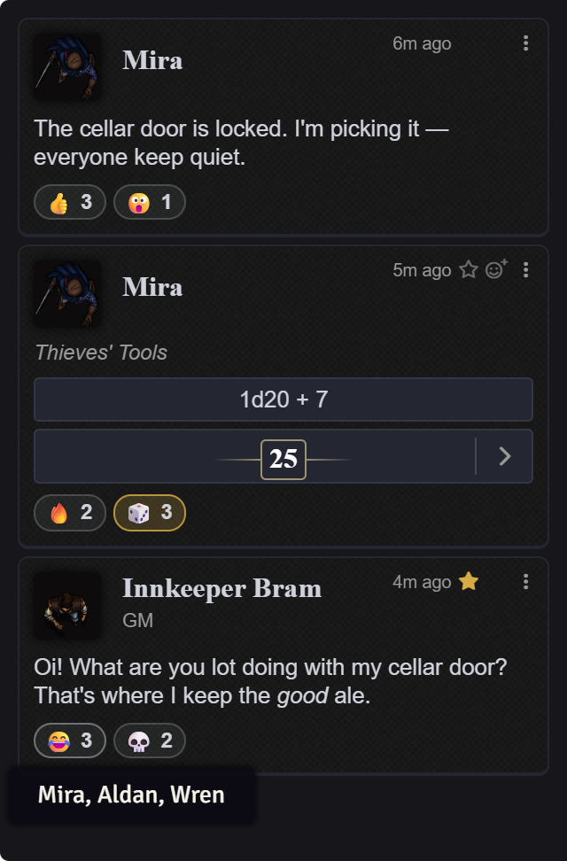
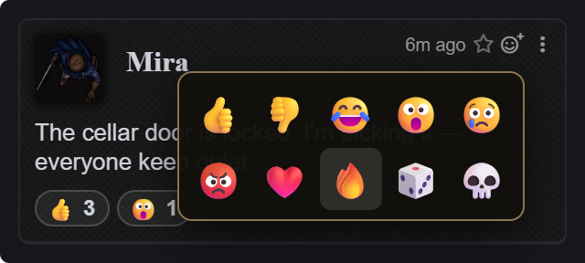
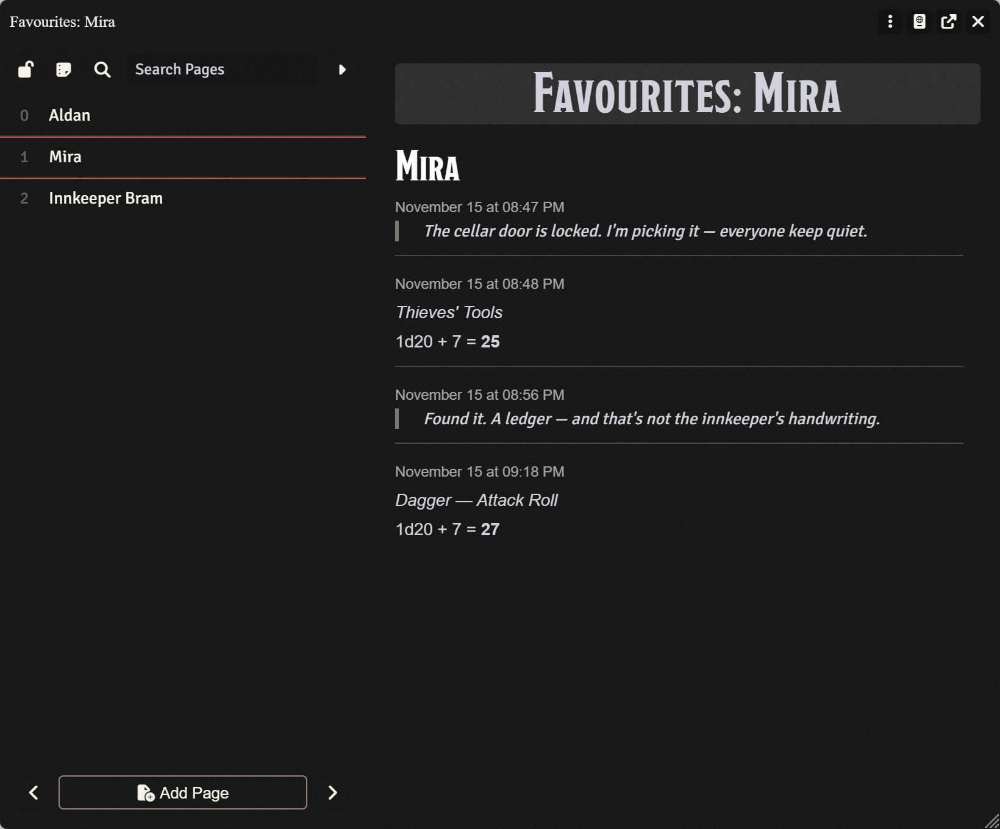

# UO · Реакции в чате

[English](README.md) · **Русский**

Отклик значком под любым сообщением чата в Foundry VTT: реплика, бросок,
карточка предмета или заклинания. Число рядом со значком — сколько человек
его поставили, кто именно — видно по наведению. Звезда уносит сообщение
в личный журнал избранного.



## Установка

В Foundry, в окне установки модулей: **«Установить модуль»**, внизу окна
вставить адрес манифеста:

```
https://github.com/Nikifour/uo-chat-reactions/releases/latest/download/module.json
```

- Foundry **v13–v14**, система любая, сторонних модулей не нужно.
- Язык — **русский и английский**: как в Foundry или на выбор в настройках модуля.
- Справка едет вместе с модулем — компендиум «Реакции в чате · Как пользоваться».

## Как пользоваться

- Навести мышь на сообщение — в шапке рядом со временем появится улыбка.
  Нажать и выбрать значок.
- Нажать на значок под сообщением — поставить такой же или снять свой.
  Свои подсвечены золотом.
- На одно сообщение можно поставить несколько значков.
- Кроме эмодзи, ведущий может добавить в набор свои значки-картинки.



## Избранное

Звезда рядом с улыбкой уносит сообщение в личный журнал **«Избранное: имя»**
в папке «Избранное»: когда и что сказано, у броска — формула и итог. Журнал
свой: его видят владелец и ведущий, остальным он закрыт.

Как записи ложатся по страницам, каждый выбирает сам:

- **на каждого, кто говорит** (по умолчанию) — всё, что сказал один
  персонаж, на одной странице. Герой узнаётся по листу персонажа,
  так что переименованный жетон страницу не раздвоит;
- **на каждого участника** — всё от одного игрока или ведущего со всеми
  его персонажами на одной странице, у каждой записи подписано, кто говорил;
- **на каждое сообщение**.



На общей странице записи идут по времени сообщений. Запись — копия,
а не ссылка: удалят сообщение или очистят чат, а запись останется.
Повторное нажатие на звезду вырезает только эту запись; то же есть
в меню сообщения по правой кнопке.

Шёпот уносят только адресаты, слепой бросок — только ведущий.

## Как устроено

Реакции хранятся флагом в самом сообщении, строкой на каждого участника,
поэтому два отклика одновременно не затирают друг друга, а после
перезагрузки всё на месте.

Чужое сообщение игроку Foundry менять не даёт, поэтому такой отклик
записывает активный ведущий: просьба уходит ему по сокету модуля.
Отправителя называет сервер Foundry, так что поставить значок от чужого
имени нельзя. Ведущего в игре нет — отреагировать можно только на свои
сообщения.

Создавать журналы игрокам Foundry тоже не даёт, поэтому первую запись
в избранное делает клиент ведущего: заводит журнал и отдаёт его игроку.
Дальше игрок пишет в свой журнал сам.

## Настройки

«Настройки → Настройки модулей → UO · Chat Reactions»:

| Настройка | По умолчанию | Что делает |
|---|---|---|
| Набор реакций | 👍 👎 😂 😮 😢 😡 ❤️ 🔥 🎲 💀 | значки в выборе, через пробел |
| Избранное: страницы (своя у каждого) | на каждого, кто говорит | как избранное ложится по страницам журнала |
| Свои значки | — | свои картинки в наборе реакций |
| Язык модуля (свой у каждого) | как в Foundry | русский, если Foundry по-русски, иначе английский; или выбрать самому |

Значки, убранные из набора, остаются под сообщениями, где их уже поставили;
снять свой можно всегда.

**Свои значки** («Свои значки → Править значки», только ведущий): свои
картинки в наборе реакций рядом с эмодзи — герб отряда, лицо трактирщика,
кружка эля. Подойдёт любой файл картинки, подпись видна по наведению.

## Лицензия

Играть можно свободно; выкладывать модуль в других местах и продавать
нельзя. Подробно — в [LICENSE](LICENSE).
